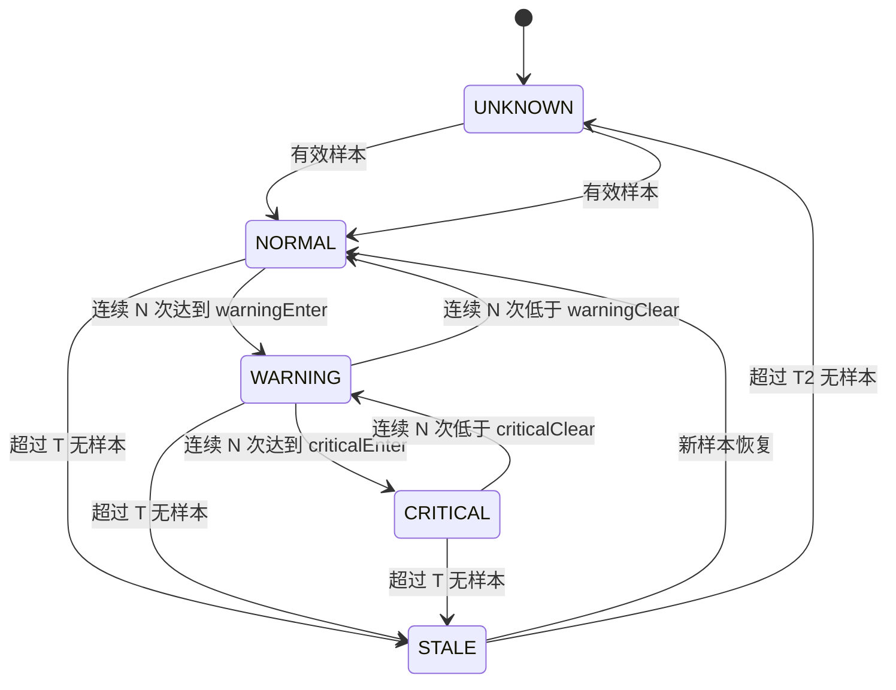
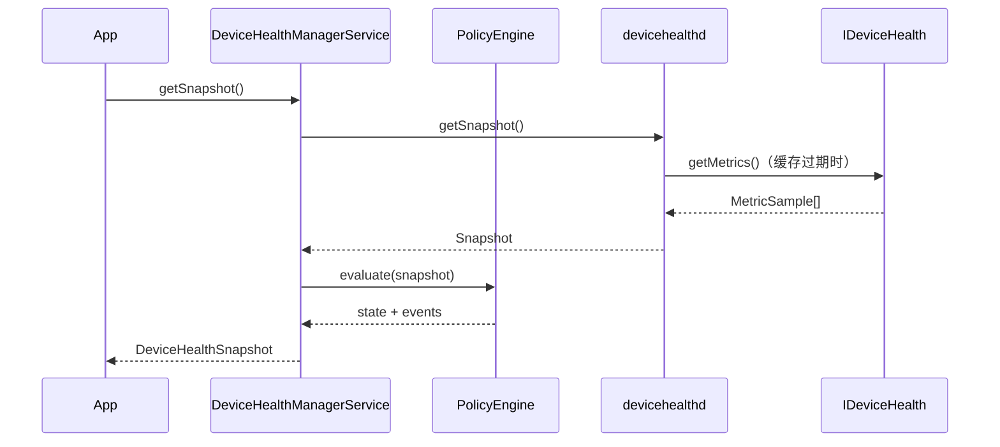
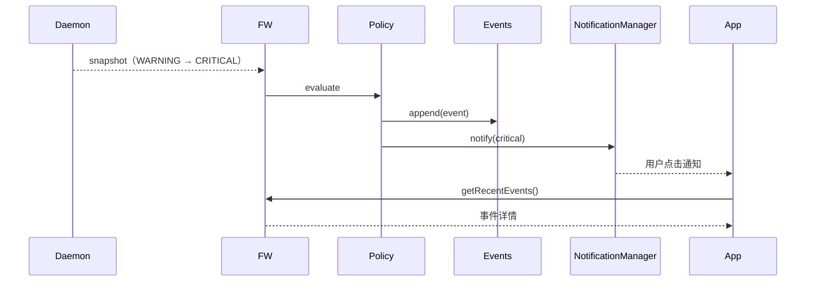
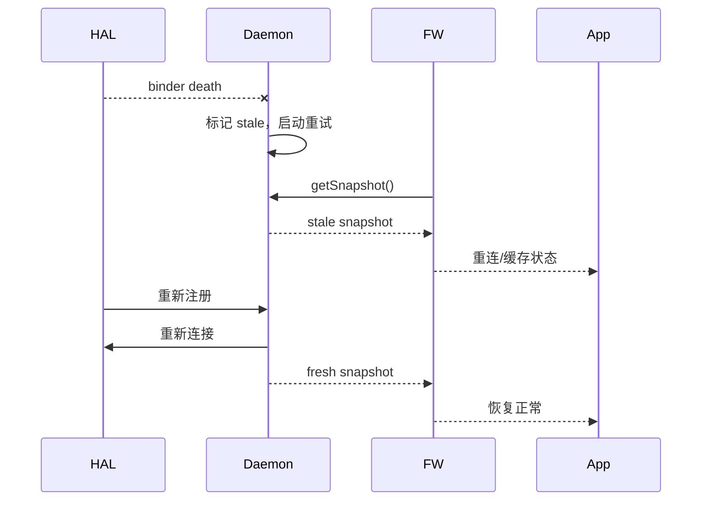
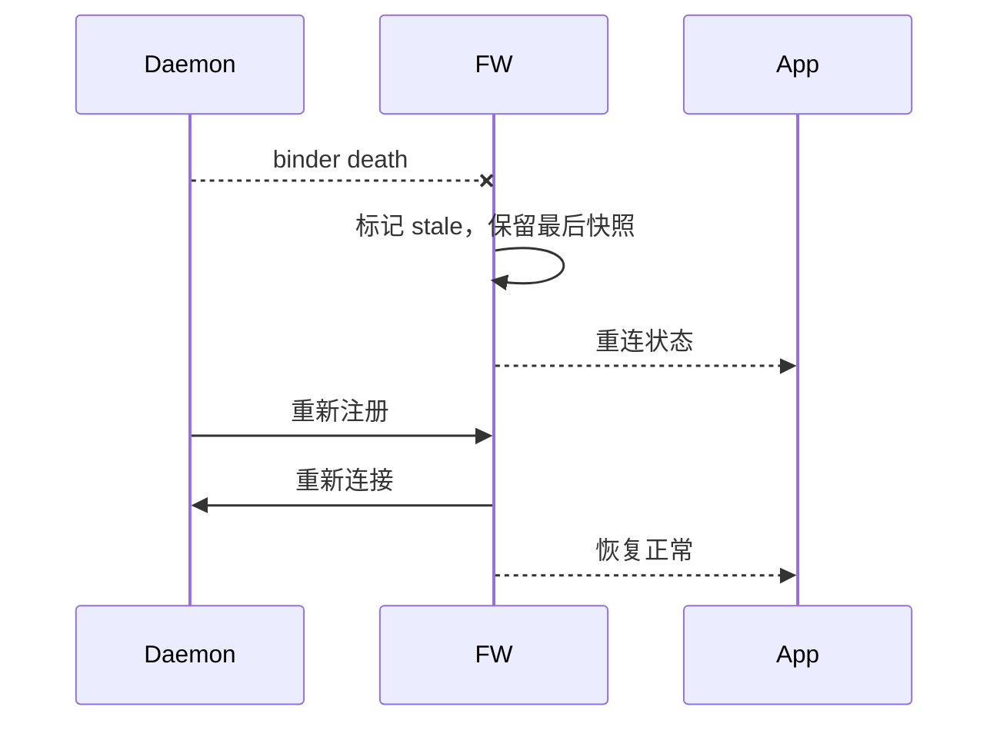
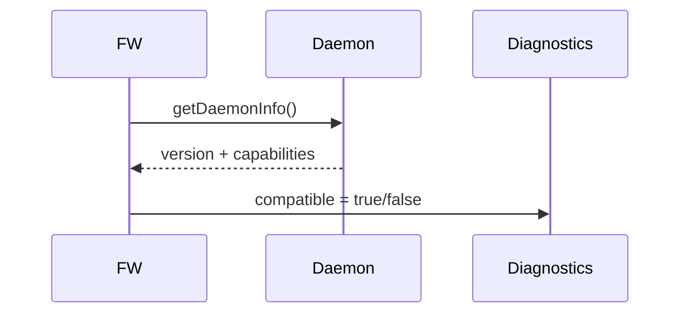

# Device Health Center 设计书

| 项目 | 内容 |
|---|---|
| 文档版本 | v1.0 |
| 状态 | 设计评审 |
| 适用基线 | android-14.0.0_r75 / SDK 34 |
| 目标设备 | Cuttlefish `vsoc_x86_64` |
| 项目定位 | HAL + Framework 跨层实战项目 |
| 更新日期 | 2026-11-22 |

---

## 1. 背景与目标

### 1.1 背景

Android 设备的温度、内存压力、电池状态等健康数据分散在 vendor HAL、native 服务和系统服务中，缺少一条统一的可观测、可告警、可诊断链路。现有学习项目往往只做到“把数据读出来”，没有回答系统发现问题后应该做什么。

Device Health Center（DHC）的目标是把这条链路做成一个完整的系统组件：

- 从 vendor HAL 采集原始数据
- 在 APEX daemon 中聚合、缓存、容错
- 在 framework 中执行策略判断、事件记录、告警和诊断
- 在 App 中提供可解释的状态、历史和自检能力

### 1.2 目标

| 编号 | 目标 | 验收方式 |
|---|---|---|
| G1 | 打通 HAL → daemon → framework → App 全链路 | `service check`、`service list`、App 数据一致 |
| G2 | 建立策略驱动的健康状态机 | 阈值、迟滞、去抖、状态跃迁事件 |
| G3 | 提供事件历史和 critical 告警 | 事件时间线、通知、深链 |
| G4 | 让 APEX daemon 具备独立升级和版本兼容能力 | 版本查询、兼容检查、可选升级实验 |
| G5 | 提供可观测和可诊断能力 | `dumpsys`、`cmd`、日志、trace |
| G6 | 具备故障降级和恢复能力 | HAL/daemon 死亡、重启、无数据场景 |

### 1.3 非目标

- 不实现真实 thermal throttling、风扇控制或降频策略。
- 不做云端、账号、多设备管理。
- 不做医疗级健康结论。
- 不编写内核驱动。
- 不为了堆功能引入重型 UI 框架。
- 不在 `system_server` 中实现数据库。

---

## 2. 设计原则

1. **数据与策略分离**：HAL 只提供原始数据，daemon 只保证数据可信，framework 才做判断和行动。
2. **每层职责单一**：每层都有明确边界，避免“为了打通而互相穿透”。
3. **稳定接口**：HAL 使用 VINTF stable AIDL；daemon 与 framework 之间使用版本化 AIDL。
4. **失败可降级**：HAL/daemon 异常时，上层必须能显示 stale/unknown，而不是崩溃或白屏。
5. **可观测优先**：每个关键状态都能通过 `dumpsys`、`cmd`、日志或 trace 解释。
6. **可在 Cuttlefish 闭环**：不依赖真机、云服务或特殊硬件。
7. **范围可控**：先做透“温度 + 内存压力”，再考虑扩展更多指标。

---

## 3. 总体架构

### 3.1 层级图

```mermaid
flowchart TB
    subgraph APP["应用层"]
        A1["DeviceHealthCenter App<br/>概览 / 事件 / 诊断"]
    end

    subgraph FRAMEWORK["Framework 层（system_server）"]
        F1["DeviceHealthManager<br/>SystemApi"]
        F2["DeviceHealthManagerService"]
        F3["Policy Engine<br/>阈值 / 迟滞 / 去抖"]
        F4["Event Bus / History"]
        F5["Notification / dumpsys / cmd"]
    end

    subgraph APEX["APEX 层"]
        D1["devicehealthd<br/>C++ / libbinder_ndk"]
        D2["Thermal Provider"]
        D3["Memory Provider"]
    end

    subgraph VENDOR["Vendor 层"]
        H1["IDeviceHealth<br/>AIDL HAL"]
        H2["thermal sysfs / 模拟数据"]
    end

    A1 -->|"SystemApi"| F1
    F1 --> F2
    F2 --> F3
    F3 --> F4
    F4 --> F5
    F2 -->|"AIDL"| D1
    D1 --> D2
    D1 --> D3
    D2 -->|"AIDL HAL"| H1
    H1 --> H2
```



ASCII 速览：

```text
┌──────────────────────────────────────┐
│ App: DeviceHealthCenter              │
│ 概览 / 事件 / 诊断                    │
└──────────────────┬───────────────────┘
                   │ SystemApi
┌──────────────────▼───────────────────┐
│ Framework: DeviceHealthManagerService│
│ Policy / Events / Notification / dumpsys │
└──────────────────┬───────────────────┘
                   │ AIDL（版本化）
┌──────────────────▼───────────────────┐
│ APEX: devicehealthd                  │
│ Thermal / Memory providers / 缓存     │
└──────────────────┬───────────────────┘
                   │ AIDL HAL
┌──────────────────▼───────────────────┐
│ Vendor: IDeviceHealth                │
│ thermal sysfs / 模拟数据              │
└──────────────────────────────────────┘
```

### 3.2 分层职责

| 层 | 组件 | 负责 | 不负责 |
|---|---|---|---|
| 应用层 | `DeviceHealthCenter` | 展示状态、事件、诊断；发起刷新；处理通知深链 | 不直接访问 HAL 或 sysfs |
| Framework | `DeviceHealthManagerService` | 权限、策略、事件、历史、通知、配置、版本检查、`dumpsys`/`cmd` | 不直接读 sysfs；不承载采样循环 |
| APEX | `devicehealthd` | 采样、聚合、缓存、stale/unknown、HAL 重连、版本和能力上报 | 不做 UI；不发系统通知 |
| Vendor HAL | `IDeviceHealth` | 读取温度/传感器数据；模拟回退 | 不做阈值判断；不保存历史 |
| 工具 | `cmd` / `dumpsys` / trace | 诊断、演示、自动化验证 | 不替代正式 API |

### 3.3 运行时视图

| 进程 | 位置 | Binder 域 | 主要职责 |
|---|---|---|---|
| vendor HAL | `/vendor/bin/hw/` | hwservicemanager | 提供 `IDeviceHealth/default` |
| `devicehealthd` | `/apex/com.android.devicehealth/bin/` | servicemanager | 提供 `IDeviceHealthService`，采样和缓存 |
| `system_server` | `/system/bin/` | servicemanager | 策略、事件、通知、权限、诊断 |
| App | `/system/priv-app/` 或 `/product/priv-app/` | 应用进程 | 展示和交互 |

关键边界：HAL 在 vendor 分区，daemon 在 APEX，system_server 在 system 分区，App 在 priv-app。四者通过 AIDL/Binder 连接，不共享内存或文件句柄。

---

## 4. 分层设计

### 4.1 HAL 层

**接口**

```aidl
package android.hardware.devicehealth;

@VintfStability
parcelable MetricSample {
    String id;
    String name;
    float value;
    String unit;
    long timestampMs;
    boolean simulated;
}

@VintfStability
interface IDeviceHealth {
    MetricSample[] getMetrics();
}
```

**职责**

- 读取 `/sys/class/thermal/thermal_zone*/temp`。
- 没有可用节点时返回模拟数据，并标记 `simulated = true`。
- 保证返回数据带时间戳和稳定 ID。
- 不缓存、不做阈值判断、不记录历史。

**集成**

- `aidl_interface` 使用 `stability: "vintf"`，C++/NDK backend。
- HAL 作为 vendor service 由 init 拉起。
- VINTF fragment 声明 `android.hardware.devicehealth`。
- SELinux 使用 HAL 域 + hwservice 权限。

**参考实现**

- [health HAL 的 Android.bp](file:///home/zqy/work/Projects/AOSP/hardware/interfaces/health/aidl/Android.bp)
- [health HAL 的 rc 模板](file:///home/zqy/work/Projects/AOSP/hardware/interfaces/health/aidl/default/android.hardware.health-service.example.rc)

### 4.2 APEX / Daemon 层

**进程与接口**

- 进程名：`devicehealthd`
- 系统 AIDL：`android.devicehealth.IDeviceHealthService`
- 服务名：`devicehealthd`（与 framework 的 `devicehealth` 区分）

**Provider 抽象**

```text
MetricProvider
├── ThermalProvider  → IDeviceHealth HAL
├── MemoryProvider   → /proc/meminfo
└── BatteryProvider  → health HAL（进阶）
```

每个 provider 只负责把原始数据转换为统一的 `MetricSample`。新增指标不需要改 framework 和 App。

**采样与缓存**

- 固定采样周期（可配置）。
- 维护最近 N 个采样点的环形缓冲。
- 返回 `Snapshot`：
  - 当前样本
  - 时间戳
  - `stale` 标记
  - daemon 版本
  - 能力位图

**容错**

- HAL 死亡：注册 binder death recipient，标记 stale，按退避策略重连。
- HAL 超时：返回缓存，不让 framework 阻塞。
- 无数据：超过阈值后标记 `UNKNOWN`。
- 进程崩溃：由 init 重启，framework 通过 death recipient 重连。

**APEX 内容**

- `bin/devicehealthd`
- `etc/devicehealthd.rc`（init 会扫描 `/apex/<name>/etc/*rc`）
- 可选：默认配置、版本信息

**参考实现**

- [adb APEX 模板](file:///home/zqy/work/Projects/AOSP/packages/modules/adb/apex/Android.bp)
- [Cuttlefish vibrator 集成方式](file:///home/zqy/work/Projects/AOSP/device/google/cuttlefish/shared/vibrator/device_vendor.mk)

### 4.3 Framework 层

**组件**

| 组件 | 职责 |
|---|---|
| `DeviceHealthManagerService` | SystemService，注册 `devicehealth`，管理生命周期 |
| `PolicyEngine` | 阈值、迟滞、去抖、状态跃迁 |
| `EventStore` | 最近事件环形缓冲、查询、限流 |
| `NotificationPublisher` | critical 通知、渠道、深链 |
| `DeviceHealthManager` | SystemApi，供 App 调用 |
| `DeviceHealthShellCommand` | `cmd devicehealth` 子命令 |
| `DeviceHealthDumper` | `dumpsys devicehealth` 输出 |

**策略引擎**

- 输入：`Snapshot`
- 输出：`HealthState` + `HealthEvent[]`
- 每个指标独立状态机。
- 只在状态跃迁时生成事件。
- critical 状态才发通知。
- 事件做去重和限流，避免刷屏。

**权限**

- 定义 `android.permission.MANAGE_DEVICE_HEALTH`，保护级别 `signature|privileged`。
- App 必须是 privileged 或平台签名。
- Service 内校验调用 UID/PID，不信任调用方参数。

**版本兼容**

- 启动时查询 daemon `getDaemonInfo()`（包含接口版本、能力、PID、最后错误）。
- 低于最低版本：进入降级模式，只展示状态，不提供事件/设置。
- 高于支持版本：忽略未知能力，记录诊断信息。

**参考实现**

- [HealthServiceWrapperAidl.java](file:///home/zqy/work/Projects/AOSP/frameworks/base/services/core/java/com/android/server/health/HealthServiceWrapperAidl.java#L57-L66)：AIDL HAL 服务访问和死亡通知模式。

### 4.4 App 层

**三屏结构**

| 页面 | 内容 |
|---|---|
| 概览 | 总体状态、最高温度、内存压力、分项卡片、趋势、最后更新时间 |
| 事件 | 时间线、严重级别筛选、事件详情、清空 |
| 诊断 | HAL/daemon/framework 状态、APEX 版本、最后错误、采样统计、自检、模拟按钮 |

**状态**

- NORMAL：正常数据。
- RECONNECTING：daemon 断开，显示缓存和重试计数。
- ERROR：HAL 不可用或权限不足，显示错误原因和重试入口。
- STALE/UNKNOWN：数据过期或未知。

**视觉**

- 浅色“晨雾白”与深色“深空黑”两套主题：卡片、环形仪表、渐变趋势、状态呼吸点、分段 Tab、胶囊筛选与按钮随主题联动。
- 固定顶栏右侧提供“深色 / 浅色”胶囊按钮，一键切换本应用明暗模式，选择由系统按应用持久化。

**交互**

- 自动刷新 + 手动刷新。
- 通知点击打开对应事件详情。
- 固定顶栏按钮切换明暗主题，重建 Activity 时保留当前 Tab 与筛选条件。
- 主题按钮点击时播放缩放与图标旋转反馈，动画结束后切换主题。
- 诊断页可触发 `simulate critical`（仅 userdebug）。

**约束**

- 不直接访问 HAL、sysfs 或 daemon binder。
- 只通过 `DeviceHealthManager` SystemApi。
- 所有 binder 调用放到后台线程。

### 4.5 可观测性与诊断

| 能力 | 实现 |
|---|---|
| `dumpsys devicehealth` | 当前快照、状态、阈值、事件、daemon 版本、最后错误、调用统计 |
| `cmd devicehealth` | `status`、`history`、`thresholds`、`simulate`、`reset`、`self-test` |
| 日志 | `logcat` tag `DeviceHealth`，关键路径带 rate limit |
| Trace | atrace/Perfetto 切片：sample、policy、event、binder |
| Bugreport | `dumpsys` 自动进入 bugreport |

---

## 5. 数据模型

### 5.1 核心类型

| 类型 | 字段 | 说明 |
|---|---|---|
| `MetricSample` | id, name, value, unit, timestampMs, simulated | 单个指标采样 |
| `Snapshot` | metrics[], timestampMs, stale, daemonVersion, capabilities | 一次完整快照 |
| `HealthState` | NORMAL, WARNING, CRITICAL, STALE, UNKNOWN | 指标/总体状态 |
| `HealthEvent` | eventId, metricId, from, to, value, threshold, timestampMs, message | 状态跃迁事件 |
| `ThresholdConfig` | warningEnter, warningClear, criticalEnter, criticalClear, debounceSamples | 阈值配置 |
| `DaemonInfo` | version, capabilities, pid, lastError | daemon 诊断信息 |

### 5.2 系统 AIDL

```aidl
package android.devicehealth;

parcelable MetricSample {
    String id;
    String name;
    float value;
    String unit;
    long timestampMs;
    boolean simulated;
}

parcelable Snapshot {
    MetricSample[] metrics;
    long timestampMs;
    boolean stale;
    int daemonVersion;
    int capabilities;
}

parcelable DaemonInfo {
    int interfaceVersion;
    int capabilities;
    int pid;
    String lastError;
}

interface IDeviceHealthService {
    Snapshot getSnapshot();
    DaemonInfo getDaemonInfo();
}
```

### 5.3 Framework SystemApi

```java
public final class DeviceHealthManager {
    public DeviceHealthSnapshot getSnapshot();
    public List<HealthEvent> getRecentEvents(int limit);
    public void registerListener(DeviceHealthListener listener);
    public void unregisterListener(DeviceHealthListener listener);
    public DaemonInfo getDaemonInfo();
}
```

---

## 6. 策略引擎

### 6.1 状态机



### 6.2 阈值示例

| 指标 | warningEnter | warningClear | criticalEnter | criticalClear | debounce |
|---|---:|---:|---:|---:|---:|
| 温度 | 65°C | 60°C | 75°C | 70°C | 3 个样本 |
| 内存压力 | 80% | 75% | 92% | 85% | 3 个样本 |

### 6.3 规则

- **迟滞**：进入和清除使用不同阈值，避免在边界反复跳变。
- **去抖**：连续 N 个样本满足条件才跃迁。
- **限流**：同一指标在短时间内最多产生一条事件。
- **通知**：只有进入 CRITICAL 才发通知；恢复不发通知，只记录事件。
- **stale**：超过 T 无样本进入 STALE；超过 T2 进入 UNKNOWN。
- **未知值**：不把 `null` 当 0，不显示虚假的正常状态。

---

## 7. 关键流程

### 7.1 正常采样



### 7.2 阈值事件与通知



### 7.3 HAL 死亡与恢复



### 7.4 Daemon 死亡与恢复



### 7.5 APEX 版本检查



---

## 8. 权限与安全

### 8.1 权限

- `android.permission.MANAGE_DEVICE_HEALTH`
- `protectionLevel="signature|privileged"`
- 只有平台签名或 privileged App 可以调用。

### 8.2 SELinux

| 域 | 权限 |
|---|---|
| `hal_devicehealth_default` | 读 thermal sysfs；注册 hwservice |
| `devicehealthd` | 访问 HAL；注册 `devicehealthd` 系统服务；读 `/proc/meminfo` |
| `priv_app` | 查找 `devicehealth` 服务 |
| `system_server` | 查找 `devicehealthd` 服务；发通知 |

要求：

- `getenforce` 为 `Enforcing`。
- 日志中无相关 `avc denied`。
- 不使用 `permissive` 或 `setenforce 0` 作为最终方案。

### 8.3 Binder 安全

- Service 内校验调用 UID/PID。
- 不信任调用方传入的阈值、路径或尺寸参数。
- 错误信息不泄露文件路径或内部地址。

---

## 9. APEX 设计

### 9.1 内容

```text
com.android.devicehealth/
├── bin/devicehealthd
├── etc/devicehealthd.rc
└── etc/devicehealth/default_config.json（可选）
```

### 9.2 签名

- 开发阶段使用 testkey。
- 生成方式：`make_key` + `avbtool extract_public_key`。
- 生产签名不在本项目范围内。

### 9.3 版本与兼容

- `DaemonInfo.interfaceVersion`：AIDL 接口版本。版本化 AIDL 自带 `getInterfaceVersion()`，不要在 AIDL 中手写同名方法。
- `DaemonInfo.capabilities`：能力位图，例如是否支持内存指标、事件订阅。
- Framework 维护最低/最高支持版本。
- 不兼容时进入降级模式，诊断页明确提示。

### 9.4 更新流程（进阶）

1. 构建 v2 APEX。
2. 通过 `apex_test` 或 `cmd apexservice` 阶段化。
3. 激活并重启 daemon。
4. Framework 重新查询版本和能力。
5. 失败时回滚到 v1。

本项目把更新/回滚作为进阶验证，不阻塞主线。

---

## 10. 可观测性设计

### 10.1 `dumpsys devicehealth`

输出分区：

```text
DeviceHealth Service
  state: NORMAL
  last update: 2026-11-22 10:00:00.123
  stale: false
  daemon: version=1 pid=1234 capabilities=0x3
  samples: 1024
  events: 3

Snapshot
  thermal.zone0: 42.3°C
  memory.pressure: 31%

Thresholds
  thermal.zone0: warn 65/60 crit 75/70
  memory.pressure: warn 80/75 crit 92/85

Recent Events
  #3 10:00:00 WARNING -> CRITICAL thermal.zone0 76.1°C
  #2 09:59:50 NORMAL -> WARNING thermal.zone0 65.4°C

Last Error
  none
```

### 10.2 `cmd devicehealth`

```text
adb shell cmd devicehealth status
adb shell cmd devicehealth history --limit 20
adb shell cmd devicehealth thresholds
adb shell cmd devicehealth simulate critical thermal.zone0
adb shell cmd devicehealth reset
adb shell cmd devicehealth self-test
```

### 10.3 Trace

| 切片 | 位置 | 用途 |
|---|---|---|
| `devicehealth.sample` | daemon | 采样耗时 |
| `devicehealth.binder` | framework | binder 调用耗时 |
| `devicehealth.policy` | framework | 策略判断耗时 |
| `devicehealth.event` | framework | 事件生成和通知 |

---

## 11. 错误处理与降级

| 场景 | 检测 | 系统行为 | App 表现 | 恢复 |
|---|---|---|---|---|
| HAL 不可用 | binder 死亡/超时 | daemon 标记 stale，重试 | 缓存 + 黄色提示 | HAL 恢复后自动重连 |
| HAL 返回异常值 | 范围校验 | 丢弃该样本，记录错误 | 保持上一次有效值 | 下一次有效样本 |
| daemon 死亡 | framework death recipient | 保留最后快照，标记 stale | 重连状态 | daemon 重启后恢复 |
| daemon 版本过低 | 版本检查 | 降级模式，禁用事件 | 诊断页提示 | 更新 APEX |
| 权限不足 | UID/PID 校验 | 返回 `SecurityException` | 明确提示无权限 | 安装为 privileged |
| 无样本 | 超时 | STALE → UNKNOWN | 不可用状态 | 新样本恢复 |
| 事件风暴 | 限流 | 合并/丢弃重复事件 | 时间线不刷屏 | 限流窗口结束 |
| APEX 缺失 | 服务查找失败 | framework 降级 | 诊断页提示 | 重新安装 APEX |
| SELinux 拒绝 | avc 日志 | 请求失败 | 错误提示 | 修 policy |

---

## 12. 测试策略

### 12.1 单元测试

- HAL 数据解析和模拟回退。
- 策略引擎：阈值、迟滞、去抖、状态跃迁。
- 事件去重和限流。
- 版本兼容判断。
- 权限校验。

### 12.2 集成测试

- HAL ↔ daemon：正常、超时、死亡、恢复。
- daemon ↔ framework：快照、版本、错误。
- framework ↔ App：SystemApi、权限、通知深链。

### 12.3 故障注入

- `stop/start` HAL。
- `stop/start devicehealthd`。
- `adb reboot`。
- 无权限调用。
- 构造 avc（测试环境）。
- APEX 版本不匹配（可选）。

### 12.4 E2E 脚本

`tools/e2e_devicehealth.sh`：

1. 检查 `service check`、`ps`、`service list`、`dumpsys`、`apexservice`。
2. 触发 warning/critical。
3. 检查事件和通知。
4. 停止/启动 daemon。
5. 停止/启动 HAL。
6. 重启设备。
7. 检查权限拒绝。
8. 收集日志、截图、dumpsys 输出。

### 12.5 性能与资源

- 采样周期内 daemon CPU 占用可控。
- binder 调用不阻塞主线程。
- 事件缓冲有上限。
- App 内存不随事件数量无限增长。

---

## 13. 实施计划

| 阶段 | 目标 | 关键任务 | 验收 |
|---|---|---|---|
| Phase 0 | 设计冻结 | 接口、数据模型、状态机、UI 线框、基线确认 | AIDL 骨架编译；职责无歧义 |
| Phase 1 | HAL + daemon | 温度 HAL、内存 provider、缓存、APEX、容错 | `service check`、`ps`、APEX active、HAL 恢复 |
| Phase 2 | Framework 策略 | SystemApi、权限、策略引擎、事件、通知、`dumpsys`/`cmd` | 阈值事件、通知、权限拒绝 |
| Phase 3 | App | 概览、事件、诊断、三态、深链 | 截图、状态恢复、事件一致 |
| Phase 4 | 可观测性/可靠性 | trace、限流、watchdog、E2E | trace 可见、E2E 通过、无 avc |
| Phase 5 | APEX 版本化（进阶） | 版本查询、兼容检查、可选 v2 升级 | 版本不匹配提示、升级/回滚 |
| Phase 6 | 交付 | 文档、demo、patch series | 可复现、视频、patch 干净 |

**MVP 截止线**：Phase 0–3 + Phase 6。Phase 4–5 为进阶项，不阻塞主线。

---

## 14. 风险与对策

| 风险 | 影响 | 对策 |
|---|---|---|
| SELinux avc | 服务起不来 | 先用最小 policy，逐条补；禁止最终使用 permissive |
| APEX 签名/init | daemon 无法启动 | 先做 APEX 空壳风险验证，再写业务 |
| SystemApi 隐藏 API | App 编译失败 | App 使用 `platform_apis: true` |
| pristine 权限 | App 无法调用 | 平台签名或 privapp allowlist |
| binder 死亡 | 页面卡死 | death recipient + 缓存 + 重试 |
| 阈值抖动 | 事件刷屏 | 迟滞 + 去抖 + 限流 |
| 资源不足 | 构建/运行失败 | 保持磁盘余量，避免并行构建多个 product |
| 范围膨胀 | 项目做不完 | 先完成 MVP，进阶项可砍 |

---

## 15. 目录结构

```text
hardware/interfaces/devicehealth/
├── aidl/
│   ├── android/hardware/devicehealth/
│   │   ├── IDeviceHealth.aidl
│   │   └── MetricSample.aidl
│   ├── aidl_api/android.hardware.devicehealth/
│   │   └── current/            # m <name>-update-api 生成；评审后 freeze 为 1/
│   ├── default/
│   │   ├── DeviceHealth.cpp
│   │   ├── DeviceHealth.h
│   │   ├── main.cpp
│   │   ├── Android.bp
│   │   └── devicehealth-default.rc
│   └── Android.bp
└── README.md

packages/modules/DeviceHealth/
├── aidl/
│   ├── android/devicehealth/
│   │   ├── IDeviceHealthService.aidl
│   │   ├── MetricSample.aidl
│   │   ├── Snapshot.aidl
│   │   └── DaemonInfo.aidl
│   ├── aidl_api/android.devicehealth/
│   │   └── current/            # m <name>-update-api 生成；评审后 freeze 为 1/
│   └── Android.bp
├── service/
│   ├── main.cpp
│   ├── DeviceHealthService.cpp
│   ├── ThermalProvider.cpp
│   ├── MemoryProvider.cpp
│   └── Android.bp
├── apex/
│   ├── Android.bp
│   ├── apex_manifest.json
│   └── devicehealthd.rc
└── docs/
    └── design.md

frameworks/base/
├── core/java/android/devicehealth/
│   ├── DeviceHealthManager.java
│   ├── DeviceHealthSnapshot.java
│   └── HealthEvent.java
└── services/core/java/com/android/server/devicehealth/
    ├── DeviceHealthManagerService.java
    ├── PolicyEngine.java
    ├── EventStore.java
    └── DeviceHealthShellCommand.java

packages/apps/DeviceHealthCenter/
├── Android.bp
├── AndroidManifest.xml
└── src/com/android/devicehealth/...
```

Cuttlefish 集成：

```text
device/google/cuttlefish/shared/devicehealth/
├── BoardConfig.mk
├── device_vendor.mk
└── sepolicy/
    ├── hal_devicehealth.te
    └── file_contexts
```

---

## 16. 验收标准

| 类别 | 标准 |
|---|---|
| 功能 | 概览、事件、诊断三屏可用；warning/critical 事件正确 |
| 可靠性 | HAL/daemon 死亡、重启、无数据可降级和恢复 |
| 安全 | 权限校验、SELinux enforcing、无 avc |
| 可观测 | `dumpsys`、`cmd`、日志、trace 能解释行为 |
| 可升级 | APEX 版本可见，兼容性有检查 |
| 性能 | 采样和 binder 不阻塞 UI；事件缓冲有上限 |
| 文档 | README 可从零复现；设计书与实现一致 |
| 演示 | Demo 覆盖正常 → 告警 → 恢复 → 诊断 → 升级 |

---

## 17. 附录

### 17.1 关键命令

```bash
source build/envsetup.sh
lunch aosp_cf_x86_64_phone-trunk_staging-userdebug
launch_cvd --daemon
adb devices

adb shell service check android.hardware.devicehealth.IDeviceHealth/default
adb shell service list | grep devicehealth
adb shell ps -A | grep devicehealthd
adb shell dumpsys devicehealth
adb shell cmd devicehealth status
adb shell cmd apexservice getActivePackages | grep devicehealth
adb shell getenforce
```

Android 14 的 `lshal` 主要列出 HIDL 服务；AIDL HAL 用 `service check` / `service list` 验证。

### 17.2 参考实现

- [health HAL 的 Android.bp](file:///home/zqy/work/Projects/AOSP/hardware/interfaces/health/aidl/Android.bp)
- [health HAL 的 rc 模板](file:///home/zqy/work/Projects/AOSP/hardware/interfaces/health/aidl/default/android.hardware.health-service.example.rc)
- [HealthServiceWrapperAidl.java](file:///home/zqy/work/Projects/AOSP/frameworks/base/services/core/java/com/android/server/health/HealthServiceWrapperAidl.java#L57-L66)
- [adb APEX 模板](file:///home/zqy/work/Projects/AOSP/packages/modules/adb/apex/Android.bp)
- [Cuttlefish vibrator 集成方式](file:///home/zqy/work/Projects/AOSP/device/google/cuttlefish/shared/vibrator/device_vendor.mk)

### 17.3 术语

| 术语 | 说明 |
|---|---|
| DHC | Device Health Center |
| HAL | Hardware Abstraction Layer |
| APEX | Android Pony Express，可独立升级的系统组件 |
| VINTF | Vendor Interface |
| stale | 数据过期但仍有缓存 |
| unknown | 长时间无数据，无法判断 |
| critical | 达到严重阈值，需要告警 |
